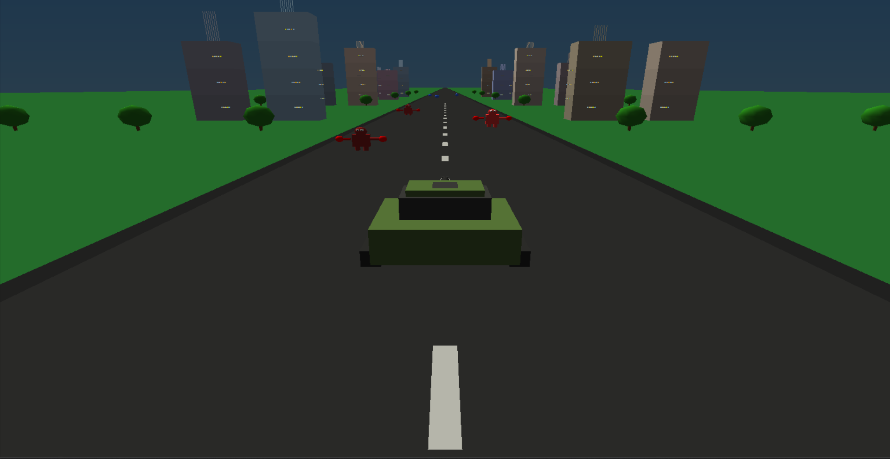

# 🚗 Tank Survival 3D (OpenGL Game)

## 📖 Overview
**Tank Survival 3D** is an OpenGL-based 3D game where the player controls a tank driving through a procedurally generated cityscape.  
Your goal is to **survive, destroy enemies, collect power-ups, and score as high as possible** while navigating the environment.  

## 👥 Teammates
- [Safin Ahmed Tonmoy](https://github.com/safinahmedtonmoy7860/Car-Game)
- [Shams Rubaiat Shammo](https://github.com/shamso-github)
- [Khandoker Md. Ragib Ahsan](https://github.com/ragibKhandoker)

  
### The game features:
- 🌆 A 3D environment with **buildings, trees, grass, and roads**  
- ☀️ Dynamic **day/evening lighting**  
- 🚀 Tank mechanics: driving, boosting, jumping, and firing shells  
- 👾 Multiple enemy spawns with AI movement  
- 💥 Particle effects for explosions, bullets, and environment  
- 🎯 HUD system showing **score, lives, and boosts**  

---

## 🕹️ Gameplay
- Drive your tank along the road while avoiding obstacles and enemies.  
- Shoot down enemies with different shell types (**armor-piercing, explosive, standard**).  
- Jump over enemies to survive.  
- Collect power-ups to increase your score.  
- Manage your lives (**5 by default**). If you run out → **Game Over**.  

---

## 🎮 Controls
| Key | Action |
|-----|--------|
| **W** | Accelerate forward |
| **S** | Brake / Reverse |
| **A** | Steer left |
| **D** | Steer right |
| **Space** | Jump |
| **R** | Reset game |
| **C** | Switch Day/Evening mode |
| **Arrow Keys** | Camera rotation |
| **F** | Fire tank shell |
| **1, 2, 3** | Change shell types |
| **L** | Toggle headlights |
| **G, H, J** | Gameplay tweaks (debug/test keys) |

---

## ⚡ Features
- 🏎️ Tank movement with **acceleration, braking, and boosting**  
- 🎯 Realistic bullet physics with **gravity, drag, and recoil**  
- 💥 Explosions & particles when bullets hit enemies/ground  
- 🌳 Procedural scenery: **buildings, trees, and grass generated dynamically**  
- 🌗 Enhanced lighting system with **day/evening toggle**  
- 👾 Enemy AI with **movement, pulsing animation, walking cycles, and collisions**  
- 🏆 Scoring system (**+15 points per enemy destroyed, +points for power-ups**)  

---
## ▶️ How to Run the Game

Follow these steps to set up and play **Tank Survival 3D**:

### 1. Download the Project
- If you have **Git** installed:
  ```bash
  git clone https://github.com/your-username/tank-survival-3d.git
  cd tank-survival-3d
# Tank Survival 3D



This is a 3D tank shooting game made with OpenGL.
## 🛠️ Requirements
Make sure you have the following installed:

- Python **3.x**  
- `PyOpenGL`  
- `PyOpenGL_accelerate`  
- **GLUT / FreeGLUT** (for rendering)  

### Install dependencies:
```bash
pip install PyOpenGL PyOpenGL_accelerate
